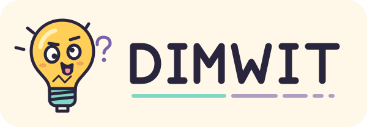

  

# DIMWIT

**Deception, Interception, & Marking Watermark Injection Toolkit**

DIMWIT is a planned Jekyll and Alpine.js web application for adding text-based prompt payloads and inspecting pasted text for supported markers and possible injection indicators.

[Application on GitHub Pages](https://squinky86.github.io/DIMWIT/) · [Source repository](https://github.com/squinky86/DIMWIT) · [Milestones](https://github.com/squinky86/DIMWIT/milestones) · [Roadmap](docs/roadmap.md) · [Architecture](docs/architecture.md)

The project is in planning. The application and generated documentation are not deployed yet. The first release, **0.0.1**, will provide a non-printing text method, a method selector, and a paste-to-inspect workflow. The main site will be the application, with documentation linked at `/DIMWIT/docs/`.

Inspection will distinguish recognized supported payloads from potential indicators and damaged data. It cannot determine the intent of arbitrary text or guarantee that a prompt is safe.

## Release plan

| Version | Scope |
| --- | --- |
| [0.0.1](https://github.com/squinky86/DIMWIT/milestone/1) | Non-printing text MVP |
| [0.0.2](https://github.com/squinky86/DIMWIT/milestone/2) | Unicode confusable substitution |
| [0.0.3](https://github.com/squinky86/DIMWIT/milestone/3) | Bidirectional control insertion |
| [0.0.4](https://github.com/squinky86/DIMWIT/milestone/4) | Encoded payload wrappers |
| [0.0.5](https://github.com/squinky86/DIMWIT/milestone/5) | Markup comment carriers |
| [0.1.0](https://github.com/squinky86/DIMWIT/milestone/6) | Beta readiness |

Versions `0.0.x` are alpha; `0.y.x` with `y >= 1` are beta. The roadmap and issue acceptance criteria are ready for review. No release dates are committed.

## Development

Implementation tasks, dependencies and release gates are tracked in [GitHub issues](https://github.com/squinky86/DIMWIT/issues). See the [0.0.1 work breakdown](docs/roadmap.md#001-work-breakdown). Build and run instructions will arrive with the application foundation.

Jekyll and Alpine.js are the intended major dependencies. The plan uses lockfiles and Dependabot for Ruby gems, npm packages and GitHub Actions, with update PRs assigned to the maintainer.

## License and artwork

DIMWIT code, documentation and original SVG artwork are licensed under **AGPL-3.0-only**. See [LICENSE](LICENSE). Third-party dependencies retain their respective licenses.

The shared [logo](assets/images/dimwit-logo.svg) and [compact icon](assets/images/dimwit-icon.svg) depict a confused little lightbulb. Application and generated documentation integration are included in 0.0.1.
